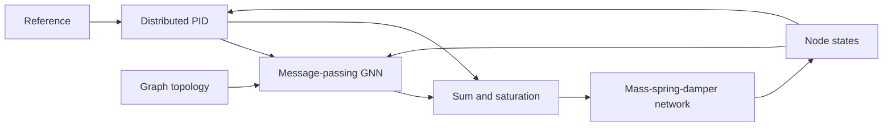
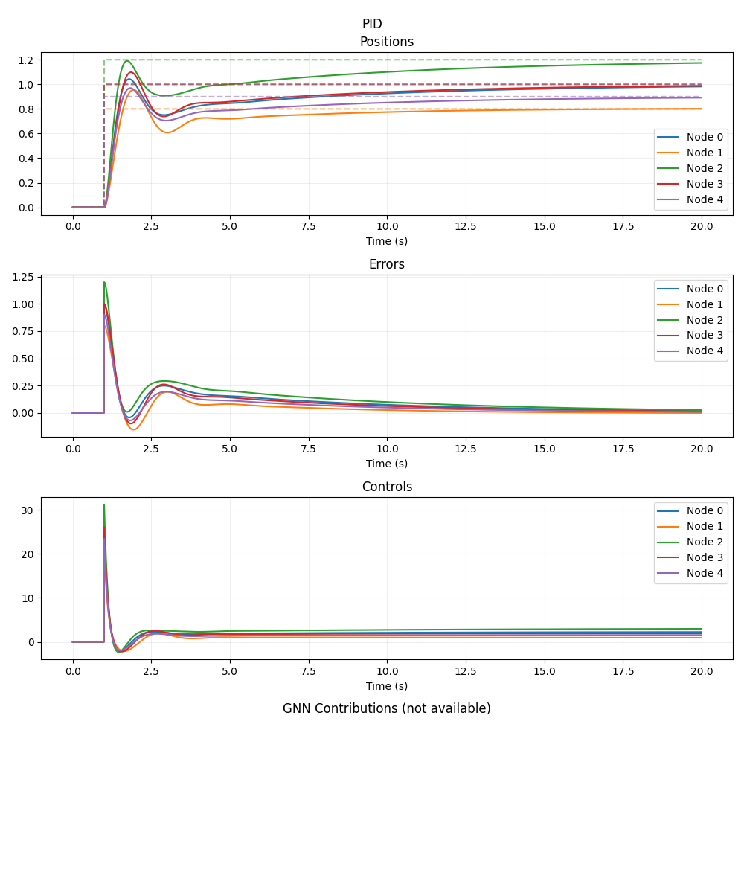
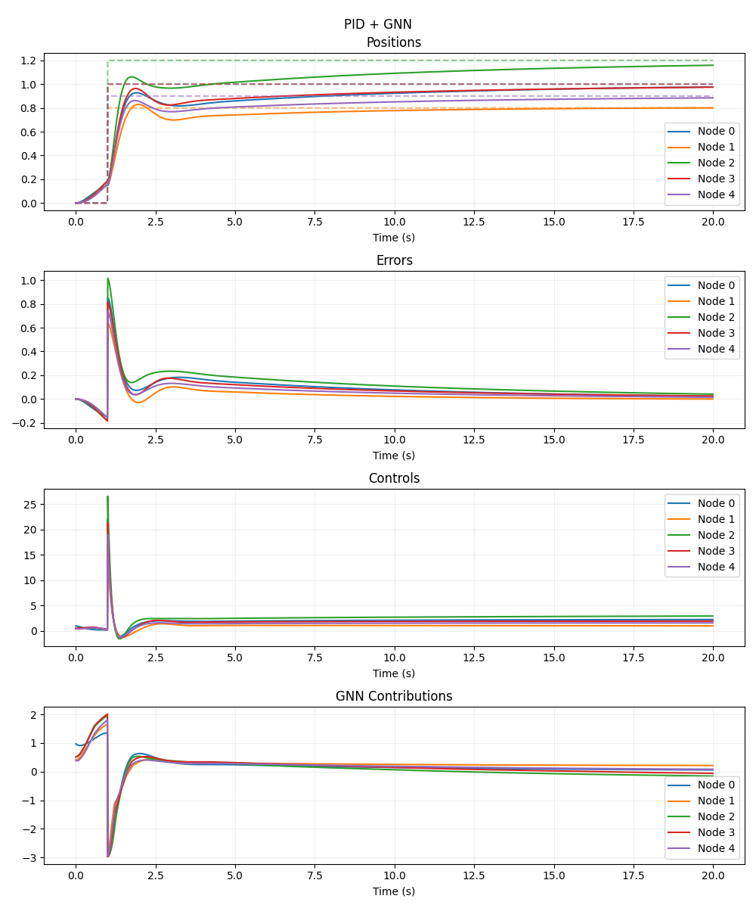

# Distributed PID Control with Topology-Aware GNN Coordination

A research prototype for residual graph-neural-network control of interconnected mass–spring–damper systems. Developed as a student research project in distributed control, numerical simulation and machine learning.

The repository contains a classical distributed PID baseline, a message-passing GNN that augments the PID control action, a differentiable simulator, training code and paired evaluation tools. All simulations run locally; no external dataset or API is required. This source-only release does not distribute pretrained weights. Train your own model from scratch using the instructions below.

## Architecture

For each node \(i\), the physical system is governed by

$$m_i\ddot{x}_i=-d_i\dot{x}_i-k_ix_i+\sum_{j\in\mathcal{N}(i)}k_{ij}(x_j-x_i)+u_i.$$

The controller uses the local tracking error, filtered error derivative and bounded integral of the error to calculate the PID action. The GNN exchanges messages between connected nodes and predicts a bounded residual correction:

$$u_i=\mathrm{clip}(u_{\mathrm{PID},i}+u_{\mathrm{GNN},i},-u_{\mathrm{sat}},u_{\mathrm{sat}}).$$

The default corrected configuration uses five nodes in a line, a two-layer MPNN with hidden dimension 64, and a correction bounded by 3. The five input features are tracking error, velocity, integral error, raw PID action and node degree. The default integrator is RK4 with a 0.01 s step.



## Two experiment configurations

| | Legacy checkpoint reproduction | Corrected v2 |
|---|---|---|
| Configuration | `configs/legacy.yaml` | `configs/default.yaml` |
| GNN messages | Original directed edge list | Both directions of each physical edge |
| Degree feature | Original unnormalized out-degree | Normalized undirected degree |
| Actuator saturation | Disabled, as in original behavior | Enabled for both controllers, ±20 |
| Zero equilibrium | Original learned residual may be nonzero | Smooth gate ensures zero correction at zero state/reference |
| Weights | Historical checkpoints (not distributed) | Train new checkpoints in `models/v2/` |

**Important:** historical weights are kept separately by the author and are not included in this release. They are compatible with legacy semantics, not a validated v2 controller. The corrected configuration requires new training. The equilibrium gate is not a proof of closed-loop stability. The actuator uses clipping and integral clamping, not a complete anti-windup design.

## Installation

Python 3.10+ is recommended. Run commands from the repository root. On Windows PowerShell:

```powershell
python -m venv .venv
.\.venv\Scripts\Activate.ps1
python -m pip install --upgrade pip
python -m pip install -r requirements.txt
```

On Linux/macOS, activate with `source .venv/bin/activate` instead. The message-passing layer uses native PyTorch `index_add_` aggregation, so PyTorch Geometric is no longer required. Install a CUDA-enabled PyTorch build separately if GPU training is desired.

## Quick start: train and evaluate your own model

```bash
python scripts/train_gnn.py --output-dir models/v2
python scripts/evaluate.py --random-scenarios 20 --seed 2026
```

The first command creates checkpoints and a saved configuration; the second loads the best checkpoint and evaluates it on matched physical scenarios. Select `--device cpu` or `--device cuda` for training if desired. To run the PID baseline before training, use `python scripts/run_baseline.py --config configs/default.yaml`.

## Historical experiments

The original checkpoint is not shipped, so the historical numbers below cannot be exactly reproduced from this release alone. If you separately possess the original checkpoint, run:

```bash
python scripts/evaluate.py --config configs/legacy.yaml --model models/gnn_model_best.pth --output-dir outputs/legacy_recheck --random-scenarios 3 --seed 2026
```

The evaluation uses matched physical parameters, reference and initial conditions for both controllers. Historical reports and plots are included as research artifacts, not as results of v2 retraining.

### Results: original saved checkpoint

The following numbers were regenerated on CPU using the archived best checkpoint, seed 2026, nominal physical parameters plus three randomized sets, 20 s simulations and the legacy configuration. They are descriptive results from four scenarios, not evidence of statistical significance or real-world performance.

| Metric (mean over four scenarios) | PID | PID + GNN |
|---|---:|---:|
| Integrated squared tracking error (ISE) | 1.8857 | 1.4725 |
| Integrated absolute tracking error (IAE) | 7.9751 | 7.9774 |
| Integrated squared control effort (U2) | 551.6991 | 454.6320 |
| Integrated squared neighbor position difference (Sync) | 2.8214 | 2.6042 |
| Mean final absolute error | 0.0150 | 0.0233 |
| Mean overshoot | 7.97% | 0.54% |
| All-node settling within tolerance | 0/4 | 0/4 |
| Maximum absolute pre-step position (scenario mean) | 0.0000 | 0.1864 |

The original GNN reduced ISE, squared control effort and overshoot in this small comparison, but did not improve IAE or final tracking error. It also moved before the reference step; this changes the effective initial conditions at the step and complicates the interpretation of its apparent improvement. Neither controller met the all-node settling criterion by the end of these runs. The corrected v2 configuration addresses the zero-equilibrium issue, but its performance has not yet been established by full retraining.

Regenerated nominal trajectories (dashed lines are references):





The original archived plots in `outputs/` are retained for historical reference. Machine-readable results are in [`comparison.json`](outputs/legacy_recheck/comparison.json).

## Training data and method

There is no fixed CSV dataset or externally labeled dataset. `src/training/rollout.py` generates trajectories during optimization using `src/dynamics/msd_network.py`. The default training configuration randomizes masses (0.8–1.2), damping (0.6–1.0), stiffness (1.6–2.4), and coupling stiffness (1.0–2.0). The topology and reference pattern remain fixed.

The training objective combines squared tracking error, velocity, control effort, GNN correction and neighboring position differences. It is optimized by backpropagation through the numerical simulation using Adam. The default run contains 25 epochs, 100 training episodes per epoch, 1,000 time steps per episode and batch size 8. The last batch now contains four episodes rather than eight; the configured total is exactly 2,500 training episodes, excluding validation. Four fixed, separately seeded simulated parameter sets are used for validation each epoch. They are sampled from the same distribution as training; they do not constitute an out-of-distribution test set.

Train the corrected version:

```bash
python scripts/train_gnn.py --output-dir models/v2
```

Use `--device cpu` or `--device cuda` to select the device. Training can be computationally expensive because gradients propagate through full trajectories. Each run saves `config.yaml`, `history.json`, `gnn_model_best.pth` (lowest validation loss) and `gnn_model_last.pth`. Existing checkpoints are not overwritten: choose a fresh output directory for each run.

Evaluate the new model after training:

```bash
python scripts/evaluate.py --config models/v2/config.yaml --model models/v2/gnn_model_best.pth --output-dir outputs/v2 --random-scenarios 20 --seed 2026
```

Use the saved run configuration, since the same tensor shapes do not guarantee equivalent feature or graph semantics.

## Metrics

- **ISE / IAE:** discrete time integrals of squared / absolute tracking errors, summed over nodes.
- **U2:** integral of squared applied control action, an effort proxy rather than physical energy.
- **Sync:** integral of squared position difference across physical edges. Because references differ by node, this is not a standalone measure of tracking success.
- **Settling time:** time from the reference step to the first sample after the last tolerance violation, provided all nodes remain within the band for at least another sample. Band = max(2% of step amplitude, 0.001 position units). `null` means not observed in the finite simulation horizon or not applicable.
- **Overshoot:** direction-aware excess beyond the final reference divided by step magnitude, averaged over active nodes; stored as a fraction in JSON.
- **Final error / peak control / pre-step movement:** diagnostic measures.

## Repository structure

```text
configs/            Experiment and controller settings
models/             Local training outputs (generated, not distributed)
scripts/            Training, individual simulations and paired evaluation
src/controllers/    PID and hybrid controller
src/dynamics/       Physical network and numerical integrators
src/gnn/            Message-passing neural network
src/training/       Rollouts, loss and optimization
src/evaluation/     Metrics and plots
src/experiment.py   Shared construction and random parameter sampling
tests/              Regression and short training tests
outputs/            Historical and regenerated experiment artifacts
```

## Tests and limitations

```bash
python -m unittest discover -s tests -v
```

The regression tests cover checkpoint serialization and loading without pretrained weights, message aggregation, bidirectional connectivity, zero equilibrium, saturation, differentiability, settling time and a short training run with an incomplete final batch. The full v2 training, GPU execution, novel topologies, disturbance rejection, measurement noise, delays, and hardware experiments have not been validated. Closed-loop stability is not guaranteed by the learned controller or by these finite simulations. Stronger research evidence would require tuned PID baselines, multiple training seeds, held-out reference patterns and topologies, and a formal stability analysis.
